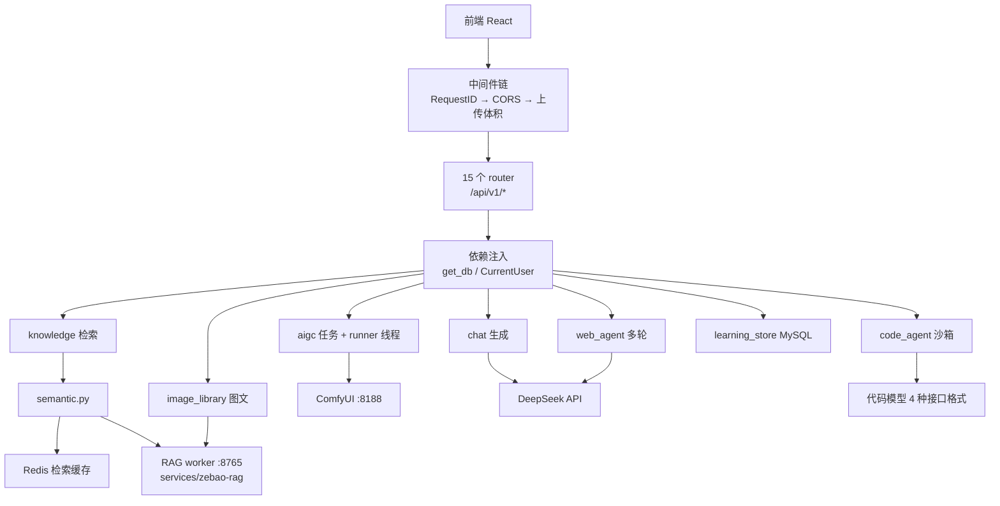
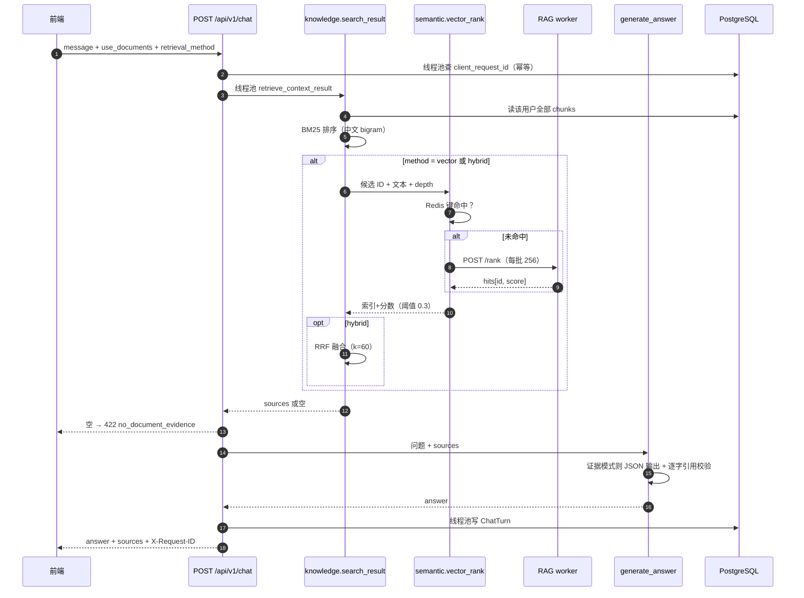

# 后端模块调用链

本文按请求路径梳理 `backend/app` 各模块的调用链，用于交接、排查和改动前的影响面判断。
内容基于对源码的逐文件阅读，不包含推测行为；标注“估算”“默认”的地方以 `core/config.py` 的默认值为准。

- 适用范围：`backend/app`（5,542 行）+ `backend/app/api/routes`（2,096 行）
- 不覆盖：前端、`services/zebao-rag` 内部实现（只在调用边界处说明）
- 更新方式：路由或服务层签名变化时同步本文，避免文档与代码漂移

---

## 0. 总装配图



---

## 1. 所有请求共用的骨架

### 1.1 中间件

[`app/main.py`](../backend/app/main.py) 依次 `add_middleware`；Starlette 后注册的在外层，实际入站顺序如下。

| 顺序 | 中间件 | 职责 |
|---|---|---|
| 1 | `APIRequestIDMiddleware` | 只处理 `/api/v1` 前缀：生成 UUID 写入 `request.state.request_id`；捕获未处理异常统一转 500 JSON；为 500 响应补 CORS；输出一条脱敏 `api_request` 日志 |
| 2 | `CORSMiddleware` | 允许 `FRONTEND_HOST` 与本机开发来源；`expose_headers=["X-Request-ID"]` |
| 3 | `DocumentUploadLimitMiddleware` | 按精确路径预判 multipart 体积并在流式读取时累计拦截：文档 256 KiB+64 KiB、代码 5 MiB、图片 1.5 MB+64 KiB |

### 1.2 依赖注入

[`app/api/deps.py`](../backend/app/api/deps.py)：

- `SessionDep`：每个请求一个 `Session(engine)`，请求结束自动关闭
- `CurrentUser`：OAuth2 Bearer → `jwt.decode` → `session.get(User, sub)` → 校验 `is_active`
- `get_current_active_superuser`：在 `CurrentUser` 之上再校验 `is_superuser`

### 1.3 启动与关闭

[`app/main.py` 的 `lifespan`](../backend/app/main.py)：

1. `AIGC_ENABLED` 时先用 `exclusive_aigc_runner` 拿 PostgreSQL 会话级咨询锁（固定 key `0x44455641494743`）
2. `aigc_runner.recover_interrupted_jobs`：把上次进程退出时停留在 `running` 的任务放回 `queued`
3. `aigc_runner.ensure_runner_started`
4. 关闭时先 `stop_runner`，再释放咨询锁

拿不到锁直接抛错拒绝启动，避免两个执行器同时领任务。

### 1.4 统一错误契约

服务层各自定义异常，路由层翻译成 `HTTPException(status, detail={code, message})`：

| 异常 | 定义位置 | 典型状态码 |
|---|---|---|
| `KnowledgeError` | `knowledge.py` | 404/413/415/422/503 |
| `ChatServiceError` | `chat.py` | 429/502/503/504 |
| `CodeAgentError` | `code_agent.py` | 403/404/409/413/415/422/502/503/504 |
| `ImageError` | `image_library.py` | 400/404/409/413/415/422/503 |
| `AgentError` | `web_agent.py` | 404 |
| `AigcError` | `aigc.py` | 400/404/409/413/415/429/500/502/504 |

`chat.py`、`agent.py` 在抛错前会写 `request.state.chat_error_code`，供请求日志的 `error_code` 字段使用。

---

## 2. 模块调用链

### A. 认证与模板底座（`login` / `users` / `items` / `private` / `utils`）

保留自 FastAPI 全栈模板，链路最短：

- `POST /login/access-token` → `crud.authenticate`（`get_user_by_email` → `security.verify_password`）→ `security.create_access_token`
- `PATCH /users/me`、`PATCH /users/me/password` → 在路由内直接调 `get_password_hash` / `verify_password`
- `POST /users/signup` → `crud.create_user`（重复邮箱 400）
- `POST /password-recovery/{email}` → `utils.generate_recovery_email` → `utils.send_email`（未配置 SMTP 时只写日志）
- `items` 全部按 `owner_id` 过滤后 CRUD
- `private.py` 只在 `FASTAPI_ENV == "development"` 时挂载
- `utils`：`POST test-email`（超管）+ `GET health-check/`

`core/security.py` 负责口令哈希与 JWT；`core/db.py` 建 `engine` 并在 `init_db` 中补建首个超管。

### B. 知识库文档（`documents.py` → `knowledge.py`）

**上传** `POST /documents`：

```
upload_document
→ knowledge.parse_document            # 扩展名白名单 .md/.txt、UTF-8、256 KiB、12 万字符、sha256
→ knowledge.split_document            # 按 # 标题切段（跳过 ``` 代码块），再 1000/150 滑窗，上限 256 块
→ SELECT user FOR UPDATE              # 序列化同一用户的并发导入，防绕过配额
→ 按 (owner_id, sha256) 查重 → 重复则 200 返回已有记录
→ 配额 20 份 → 插 Document → flush → 批量插 DocumentChunk → commit
```

**列表 / 详情 / 删除**：`read_documents` 直接 SQLModel 查询 + `count`；`read_document` 先走 `knowledge.owned_document`（不存在或不属于当前用户一律 404），再按 `position` 取全部 chunk；`delete_document` 校验归属后删除，片段由外键 `ondelete="CASCADE"` 级联。

### C. 检索（`knowledge.py` + `semantic.py` + `retrieval_cache.py` + RAG worker）

核心函数 `knowledge.search_result`，被三个入口复用：`POST /documents/search`、`POST /chat`、`POST /learning/compare`。

```
search_result(session, owner_id, query, limit, document_id, method, vector_store)
├─ 指定 document_id → owned_document 先鉴权
├─ 一次查出该用户全部 (DocumentChunk ⋈ Document)，含 filename/heading/content
├─ depth = 20（hybrid）或 limit
├─ method != vector → rank_chunks(key=…)     # 自实现 BM25：k1=1.5 b=0.5，
│                                             # 中文按 bigram 分词，整句命中 ×2.0 加成；
│                                             # 分词按 chunk id 快照做进程内 LRU 缓存
├─ method != bm25   → semantic.vector_rank() # 见下
│    └─ hybrid       → fuse_rankings()       # RRF，k=60
├─ vector 失败：method=vector 直接 503；hybrid 降级 bm25 并带 warning
└─ 组装 KnowledgeSource（citation=S1…、行号、原文、score）
```

**语义分支** `semantic.vector_rank`（带 `@observe_operation`）：

1. 开关/容量校验：`RAG_WORKER_ENABLED`、候选 ≤ 20×256
2. Redis 键为 `sha256(embedding_identity, namespace, engine, query, ids, texts, limit)`，TTL 180 s，只存 `hits[id,score]`，不存原文
3. 未命中 → 读 `.local/zebao-rag/worker.token` → 每 256 条一批 `POST {RAG_WORKER_URL}/rank`（`trust_env=False`、不跟随重定向）→ 按分数回填全局索引
4. 只缓存“整快照的全局 top K”，不缓存分批中间结果
5. `validate_hits` 白名单校验：返回 ID 必须来自本次授权的 SQL 快照，分数须在 [-1,1] 且 ≥ `RAG_MIN_SIMILARITY`

worker 侧实现在 `services/zebao-rag/src/zebao_rag/worker.py`：标准库 HTTP server，暴露 `/rank` 与 `/embed`，Bearer token 鉴权，内部按 `RAG_VECTOR_STORE` 走 Milvus 或 Chroma。

### D. 问答（`chat.py` 路由 + `app/chat.py` + `grounded_answer.py`）

`POST /chat` 是全项目最长的一条链：

```
create_chat
├─ 幂等：client_request_id 存在 → 线程池 _find_existing_turn
│   ├─ 命中且 request_hash 一致 → 直接回放 ChatTurn
│   └─ 命中但 hash 不同 → 409 idempotency_key_reused
├─ use_documents=true → 线程池 retrieve_context_result（独立 Session，因不在事件循环线程）
│   ├─ KnowledgeError → 原状态码返回
│   └─ sources 为空 → 422 no_document_evidence（不调用模型）
├─ generate_answer(message, request_id, sources)
│   ├─ 无 key → 503 model_not_configured
│   ├─ asyncio.timeout(CHAT_TOTAL_TIMEOUT_SECONDS) 包住整个重试循环
│   ├─ _request_answer：最多 2 次；只对连接阶段失败与 429/5xx 重试
│   ├─ 有 sources 且 CHAT_VALIDATE_DOCUMENT_EVIDENCE=true
│   │   → build_grounded_messages + response_format=json_object
│   │   → parse_grounded_answer：严格字段、quote 必须逐字出现在对应来源、
│   │     answer 每个段落带 [S?n]、引用集合须 ⊆ 已验证证据
│   └─ 否则 → 普通 system+user 两段式
└─ 线程池 _persist_chat_turn（唯一约束 owner+client_request_id、request_id）
    └─ 唯一键冲突时回查已有记录并回放，否则 503 chat_history_persistence_failed
```

`_request_answer` 的错误映射：401/403→503、429→429、5xx→502、响应结构异常→502；`APITimeoutError` 只在底层是连接超时时重试。

`GET /chat/history`、`GET /chat/history/{id}` 直接读 `ChatTurn`；`sources_json` 反序列化失败 → 500 `chat_history_corrupt`。

> `/chat` 是单轮设计：每次只发送当前问题，不自动把历史回答拼进上下文。

### E. 多轮 Agent（`agent.py` 路由 + `web_agent.py`）

`POST /agent/turns` → `run_turn`：

```
run_turn
├─ 线程池 _prepare
│   ├─ _load_history：session_id 存在则鉴权后取最近 4 轮（AGENT_KEEP_TURNS）
│   └─ collect_evidence(owner, message)
│       ├─ retrieve_context_result(method="bm25") 取 top 3
│       └─ image_library.search_text(limit=3)   # 图片检索失败不致命，记一条 [图片检索失败]
├─ 短路：工具失败 → 直接回「检索工具失败」；无命中且无历史 → 不调模型，回 EMPTY_ANSWER
├─ _model_loop：最多 5 步
│   ├─ _complete（AsyncOpenAI + tools=TOOL_SPECS，同样 2 次重试 / 超时预算）
│   ├─ 无 tool_calls → 返回 content
│   ├─ 有 tool_calls → 逐个线程池 _execute_tool：只认 search_knowledge，
│   │   query 截 1000 字，top_k 容错为 3 → 再走 collect_evidence
│   └─ 满 5 步未收敛 → STOP_ANSWER，stopped=True
└─ 线程池 _save_turn：无 session_id 先建 AgentSession，写 AgentTurn（含 steps_json）
```

`GET /agent/sessions`、`GET /agent/sessions/{id}` 只读，按 `owner_id` 过滤。

### F. 编程工作台（`code.py` 路由 + `code_agent.py`，1,285 行）

**文件类操作**全部 `run_in_threadpool`（同步文件 IO）：

| 端点 | 链路 |
|---|---|
| `GET /code/workspace` | `list_workspace` → `_owner_root` 建 `CODE_WORKSPACE_DIR/<user_id>`（0700）→ `rglob` 过滤符号链接/非普通文件 → `normalize_workspace_path`（禁 `..`、反斜杠、隐藏名、扩展名白名单）→ 50 文件 / 4 MiB 上限 |
| `GET/PUT/DELETE /workspace/files` | `read_workspace_file_with_version` / `save_workspace_file` / `delete_workspace_file`，写操作统一走 `_workspace_writer` |
| `POST /workspace/diff` | `review_workspace_diff` → `diff_text`（`difflib.SequenceMatcher`；前后行数乘积 > 200 万直接 422 `diff_too_complex`；默认只输出前 80 行） |
| `POST /workspace/files`（上传） | `store_workspace_uploads` |
| `POST /workspace/github` | `import_github_repository` → 解析 `owner/repo` → GitHub API 列树 → 只取文本/代码 → 最多 15 个文件 |
| `POST /workspace/apply` | 先校验权限与确认标志 → `apply_workspace_edits` |

**写保护三层**（`_workspace_writer`）：

1. 进程内 `threading` 锁
2. `flock` 文件锁（`.locks/<owner>.lock`，`O_NOFOLLOW`，macOS 上 ENOENT 重试 3 次）——只保护“配合的应用进程”，外部程序直接改盘不受保护
3. 提交前逐个比对 `base_version`（`sha256:` 前缀），任一不符 → 整批 409，不写入

**生成链路** `POST /code/generate`：

```
generate_code
├─ asyncio.to_thread(_read_workspace_context)   # 最多 20 个路径、累计 64 KiB
├─ system prompt + 目标/任务/文件内容（明确标注为不可信数据）
├─ _request_model
│   ├─ _model_settings 决定 model/key/base_url：
│   │   三项全空 + openai_chat_completions → 复用 DEEPSEEK_*
│   │   本机域名（localhost/127.0.0.1/::1/host.docker.internal）且无 key → 填占位符
│   ├─ _provider_request 按 4 种格式构造 endpoint + payload
│   ├─ _provider_headers 按格式放 Authorization / x-api-key / x-goog-api-key
│   ├─ 2 次尝试；只有 ConnectError/ConnectTimeout 才重试
│   └─ _extract_provider_text 按格式解析各自响应
├─ _extract_json_object（容忍 ```json 围栏，按括号深度扫描）
├─ CodeAgentOutput.model_validate_json → _validate_edits（路径/扩展名/数量/大小）
└─ plan_only=true 时丢弃 edits 并在 summary 追加说明
```

`_apply_workspace_edits`：先整体校验版本与配额 → 每个文件写 `.rollback-` 备份 + 临时文件 → 逐个 `os.replace` → 任一步失败逆序回滚；回滚也失败则 500 `workspace_rollback_failed`。

### G. 图片检索（`images.py` 路由 + `image_library.py`）

```
上传 POST /images
→ parse_image（先看扩展名再验魔数；JPG/PNG；≤1.5 MB；sha256）
→ embed_image → _embed → POST {RAG_WORKER_URL}/embed（kind=image, base64, is_query=false）
→ SELECT user FOR UPDATE → 二次查重 → 配额 20 张
→ 先写盘（IMAGE_LIBRARY_DIR/<user>/<id>.jpg|png）再 commit；IntegrityError 回滚并删文件

文字搜图 POST /images/search
→ search_text → embed_text(is_query=true) → _owned_assets（只取本人）
→ _rank：Python 里逐条算余弦；维度不一致直接 503 embedding_mismatch

以图搜图 POST /images/search-by-image
→ parse_image 校验 → embed_image → 同样的 _rank
```

检索是**遍历本人图片**，不经过向量库；向量以 JSON 存在 PG 的 `ImageAsset.embedding_json`。

### H. AIGC 视频（`aigc.py` 路由 + `app/aigc.py` + `aigc_runner.py`）

单卡串行队列，HTTP 提交即返回：

```
POST /aigc/jobs（文生视频）
├─ _ensure_enabled → kind 必须是 text2video
├─ _ensure_queue_capacity：该用户 active < AIGC_MAX_QUEUE_DEPTH（默认 4）
├─ _ensure_comfy_reachable：ComfyClient.system_stats() 探活
└─ _create_job：写 AigcJob(status=queued) → commit → ensure_runner_started()

POST /aigc/jobs/image（图生视频）
→ 校验 content-type / 大小 / params → 线程池 _persist_image_job
  → 先落盘 uploads/<user>/<job_id>.<suffix> → 再建 queued 任务

后台线程 _worker_loop（模块级单线程）
→ _claim_next_job：SELECT 最早 queued ... FOR UPDATE SKIP LOCKED
  （行锁覆盖「选中 → 置为 running」，不阻塞在别的事务持有的行上）
→ run_job：
   VideoParams.from_json → ComfyClient.system_stats
   → 图生视频先 upload_image 把首帧传给 ComfyUI
   → build_prompt 组 ComfyUI workflow 图 → submit 得 prompt_id（回写 DB）
   → 轮询：先查取消 → history() 判 error/success
       success → saved_videos → download 到 AIGC_OUTPUT_DIR → _finish
       error   → 502 aigc_execution_failed
       超时    → interrupt() + 504 aigc_timeout
   → 每次轮询更新 progress（estimate_progress 按 elapsed/estimate_seconds 估算）
     和 status_message（队列位置，每 3 次轮询查一次 queue()）
```

取消只改 DB 状态，worker 下一轮轮询捕获后 `interrupt()`；删除要求终态，并删产物与首帧文件；`GET /jobs/{id}/video` 用 `FileResponse` 直出。

> `progress` 是估算值，不是 ComfyUI 真实步数（ComfyUI 只提供 websocket 级进度，HTTP 拿不到）。

### I. 学习实验（`learning.py` 路由 + `learning_store.py`）

- 记录 CRUD → MySQL（`MYSQL_DATABASE_URL`，否则读 `.local/mysql.env` 拼 URL），只建自己的 `learning_record` 表；连接超时 2 s、读写超时 3 s；异常统一 503 `learning_store_unavailable`
- `GET /learning/cache/stats` → `retrieval_cache.stats(owner_id)`，Redis 异常时降级 `{available:false}`
- `POST /learning/compare` → 先确认有文档、校验 `document_id` 归属、预连一次 MySQL（保证结果能落库）→ 对 `milvus` / `chroma` 各跑一次 `search_result(method="vector", vector_store=store)` → 比较命中交集 → 写一条 `kind="comparison"` 记录

这是唯一一条同时串起 PG + MySQL + Redis + 两个向量库的链路。

### J. 笔记 / 任务（`notes.py` / `tasks.py`）

纯 owner-scoped CRUD，无服务层：列表（`skip/limit` + `count`）→ 创建 → 局部更新（先查归属，404）→ 删除 204。

### K. 离线评估（不在请求链上）

两个模块只被 CLI 脚本调用，**不注册路由**：

| 脚本 | 入口 | 链路 |
|---|---|---|
| `backend/scripts/evaluate-retrieval.py` | `retrieval_eval.evaluate` | `load_dataset` → 每个 case `evaluate_case`（纯 BM25，无 DB/密钥）→ `aggregate` → `render_markdown` 写 `docs/RETRIEVAL_EVAL_REPORT.md`；`--strict/--gate` 控制退出码 |
| `backend/scripts/evaluate-answerability.py` | `answerability_eval.*` | `load_dataset` → `sources_for` → `messages_for` → 直连本地模型 HTTP → `classify_response` 判定 answerable/abstain/quote 逐字 → `summarize_results` + `render_markdown` |

### L. 横切模块

| 文件 | 作用 |
|---|---|
| `core/config.py` | 全部 `Settings`；`RAG_WORKER_URL` 与 `AIGC_COMFY_URL` 有 validator 强校验（必须本机回环、不能带路径/查询/凭据） |
| `core/observability.py` | `request_id_context`、httpx 日志 URL 脱敏、`@observe_operation` 记录耗时/结果（不记参数与返回值） |
| `core/device.py` | 解析 macOS `vm_stat` / Linux `meminfo`，计算可用内存余量，供 AIGC 启动前判断 |
| `core/upload_limit.py` / `core/request_id.py` / `core/aigc_lock.py` | 见第 1 节 |

---

## 3. 一次 RAG 问答的完整时序



---

## 4. 资源归属速查

| 资源 | 存在哪 | 归属过滤 |
|---|---|---|
| 用户 / 文档 / 片段 / 会话 / 任务 / 笔记 | PostgreSQL（SQLModel） | 全部 `owner_id ==` |
| 学习记录 | MySQL（独立 engine） | `owner_id` 列 + 路由传入 |
| 检索命中缓存 | Redis（TTL 180 s） | key 中含 `namespace=owner_id` |
| 向量 | Milvus / Chroma（worker 进程持有） | RPC 前用 SQL 快照做白名单 |
| 图片 | 文件系统 `IMAGE_LIBRARY_DIR/<user>/`；向量在 PG 的 JSON 列 | 路径由 user_id + image_id 拼出 |
| 代码工作区 | 文件系统 `CODE_WORKSPACE_DIR/<user>/`；flock 串行 | 路径规范化 + `is_relative_to` |
| AIGC 产物 | 文件系统 `AIGC_OUTPUT_DIR`；元数据在 PG | `owner_id` + relpath 拼接 |

---

## 5. 已知限制与观察点

1. **单轮 vs 多轮是刻意分离的**：`/chat` 每次只发当前问题，上下文能力只给 `/agent`（4 轮 + 5 步）。
2. **检索是“小规模全量 + 内存排序”**：`search_result` 每次把该用户所有 chunk 拉进内存做 BM25；配额上限 20 文档 × 256 块 = 5,120 条。分词结果按「这批 chunk id 的哈希」做进程内 LRU 缓存（`_CORPUS_CACHE_SIZE = 4`，一快照约 6 MiB），5,120 段的排序从 599 ms 降到约 12 ms；文档增删会换 key 自动失效。代价是缓存是进程内的，多实例各存一份，且配额放开后仍会线性增长。
3. **线程池是硬边界**：会阻塞的同步 IO（DB 查询、文件读写、flock、worker RPC、AIGC 落盘）都显式 `run_in_threadpool` / `asyncio.to_thread`；事件循环里只留 `await`。
4. **Python 3.14 语法**：`except InvalidTokenError, ValidationError:`（`api/deps.py`）等使用 PEP 758 的无括号多异常写法，在 3.13 及以下会 `SyntaxError`。`.python-version` 锁 3.14。
5. **`_claim_next_job` 用 `FOR UPDATE SKIP LOCKED` 领取**：行锁覆盖「选中 → 置为 running」，被取消请求或另一执行器持有的行会被跳过而不是阻塞。SQLite 不支持该子句（SQLAlchemy 静默省略），因此锁语义只在 PostgreSQL 生效；单实例部署仍由 `exclusive_aigc_runner` 的咨询锁保证。
6. **图片与语义检索共享 worker 依赖**：两者都依赖 `.local/zebao-rag/worker.token` + `RAG_WORKER_URL`。worker 未启动时表现为 503 降级，不会崩溃。
