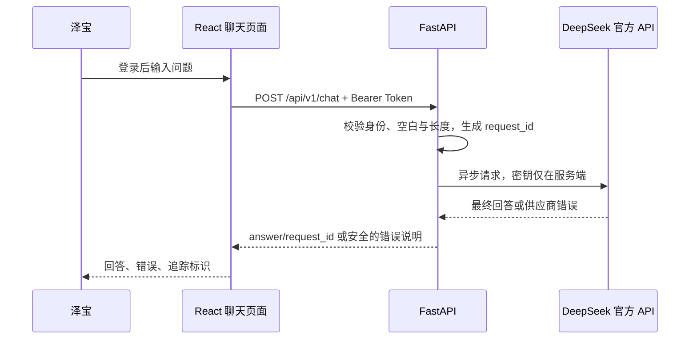

# 第一阶段：理解一条模型问答请求

本文件记录第一阶段的单轮问答学习链。普通模式不读取文档，聊天记录不保存；已新增的文档模式与检索流程见 [第二阶段说明](PHASE2.md)。

## 请求链路

## 先读哪些代码

1. 前端 chat 页面和聊天适配器：查看加载状态、重复提交保护，以及如何复用已有登录 token。
2. 后端 chat 路由：查看 Pydantic 参数校验与认证依赖，API 层不直接处理供应商细节。
3. 模型服务：查看 OpenAI 异步 SDK、总超时与有限重试。async 不会让模型本身更快，但等待网络时会把控制权交还事件循环，同一进程还能处理其他请求。
4. request-id 中间件：查看错误发生在认证或参数校验时，为什么响应仍然带有追踪标识。

| 文件 | 负责什么 |
|---|---|
| `frontend/src/routes/_layout/chat.tsx` | 校验输入、禁用重复提交、显示结果 |
| `frontend/src/lib/chat.ts` | 附带登录 token，发送请求并解释错误 |
| `backend/app/api/routes/chat.py` | 验证登录身份，接收问题，返回统一结果 |
| `backend/app/chat.py` | 输入模型与 DeepSeek 调用、总预算和重试 |
| `backend/app/core/config.py` | 从根目录 `.env` 读取配置并校验范围 |
| `backend/app/core/request_id.py` | 为成功或失败的聊天请求添加标识和安全日志 |

## 这条链路中的设计取舍

参数校验使用 Pydantic（数据校验库）：先去除首尾空白，再检查字符串长度。浏览器校验减少无效请求，后端校验保证绕过页面的请求也受限制。后端的 422 表示输入不符合接口要求，401 表示尚未登录，二者都不会调用模型。

后端使用异步 SDK 配合 `await` 等待网络响应。直接在异步接口中调用同步、阻塞的 HTTP 客户端会卡住事件循环，影响其他请求；长时间的文档解析或训练任务也不应直接放在这类请求中执行。

30 秒是整次模型操作的预算，由 `asyncio.timeout` 和剩余时间控制，包含请求、最多一次重试、等待和客户端关闭。它不是“每次请求都可等待 30 秒”。SDK 自动重试关闭，避免两层重试造成请求数和时间失控。只有连接建立失败、明确的 429（限流）和 5xx（上游服务错误）可以再次尝试；读取超时可能发生在模型已处理请求之后，因此直接结束，避免重复产生费用。

前端等待上限为 35 秒，为后端的 30 秒预算和网络传输留出余量。供应商异常由后端转成项目自己的状态码和中文说明，前端读取 `X-Request-ID` 帮助定位日志。日志记录耗时、错误码和 token 用量，不需要记录完整问题或回答。

## 你亲手完成的小练习

- 将 `ChatRequest.message` 的输入上限从 4000 改为 2000，同时调整前端校验、字数显示和提示；提交 2000 字符与 2001 字符的问题，验证边界，再恢复到 4000。当前没有密钥时，合法输入返回 503，超长输入返回 422，这也能验证输入层是否生效。
- 在本地 `.env` 将 `CHAT_TOTAL_TIMEOUT_SECONDS` 改为 10，重启后端；从 backend 运行 `uv run --frozen python -c 'from app.core.config import settings; print(settings.CHAT_TOTAL_TIMEOUT_SECONDS)'`，确认配置值为 10，再恢复为 30。没有密钥时会提前返回 503，不会触发模型超时；模拟预算行为可阅读 `test_total_timeout_includes_both_attempts` 与 `test_total_timeout_includes_retry_backoff`，不需要真实 API Key。
- 阅读一次 429 与读取超时的测试：解释为什么前者最多重试一次，后者直接结束。
- 用自己的话解释：进程存活、数据库连通、配置存在、模型 API 可用分别由什么证据证明。

## 面试练习

“我基于 FastAPI 官方全栈模板开发了 DevAssist。第一阶段实现认证后的单轮模型问答，新增功能包括参数校验、异步模型适配、整体时间预算、有限重试、错误分类和请求标识。模型密钥仅保存在服务端本地配置，前端显示最终答案与可追踪错误。”

这段描述只能在对应验收通过后使用。当前阶段不应描述为已有 RAG、自主 Agent、生产部署或模型训练成果。
