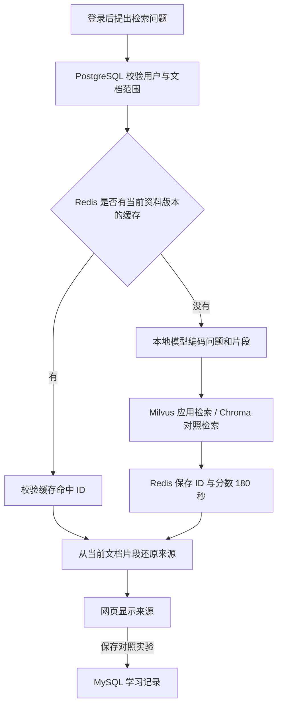

# 泽宝的五种数据库练习

这个安排用于分阶段学习和项目演示。每次只练一个可观察的行为；已经搭好的功能不等于你已经掌握，
完成练习、能解释结果后，再把它写进自己的项目总结。

## 先记住各自保存什么

| 数据库 | 本项目中的实际用途 | 对应代码 | 先学到什么程度 |
|---|---|---|---|
| PostgreSQL | 用户、登录关联数据、文档和片段 | `backend/app/models.py`、`knowledge.py` | 看懂主键、外键、用户归属与一次查询 |
| MySQL | 学习记录和检索对照实验 | `backend/app/learning_store.py` | 能解释新增、列表、删除和 owner_id 条件 |
| Redis | 180 秒检索缓存和缓存计数 | `backend/app/retrieval_cache.py` | 看懂键、值、有效期和命中/未命中 |
| Milvus | 应用向量的持久化与检索 | `services/zebao-rag/src/zebao_rag/milvus_store.py` | 理解向量、集合、相似度和权限过滤 |
| Chroma | 同模型同资料的本地检索对照 | `services/zebao-rag/src/zebao_rag/worker.py` | 能实际比较结果，知道临时索引与持久索引的差别 |

PostgreSQL 与 MySQL 都是关系数据库，并非必须同时使用。这里保留模板现有 PostgreSQL，
用独立的 MySQL 学习记录模块练习第二种关系数据库，避免重复存储同一批账号和文档。
Milvus 和 Chroma 同样有能力重叠，这里明确安排为“应用检索 + 实验对照”。

## 启动和入口

在项目根目录运行：

```bash
bash scripts/devassist-dev.sh --with-rag
```

脚本启动本项目独立的 PostgreSQL、MySQL、Redis、Milvus 及其依赖，初始化 MySQL 的
`devassist_learning_records` 表，再启动本地模型进程和前后端。Chroma 在模型进程中运行，
不需要再启动容器。首次需要已有模型缓存或显式设置 `HF_HUB_OFFLINE=0` 下载。

登录后打开 `http://localhost:5173/learning`，左侧也有“学习实验”。密码仍保留在本机 `.env` 中；不要写入学习记录。
MySQL 默认复用 `.local/mysql.env` 中本项目自己的连接信息，不打印密码。

## 五个练习，按顺序做

| 阶段 | 任务 | 项目产出 | 验收标准 |
|---|---|---|---|
| 1. 文档持久保存 | 在知识库上传一份十行以内的 Markdown，预览片段并刷新 | PostgreSQL 中自己的文档 | 刷新后文档仍在；标题、行号和原文能对应 |
| 2. 学习记录 | 在学习实验页写“我理解的文档与缓存差别”，保存后刷新 | MySQL 中一条自己写的记录 | 刷新后仍能读到；第二个账号看不到它 |
| 3. 语义检索 | 对文档换一种说法提问，选语义或混合检索 | Milvus 检索结果与来源 | 能打开原文，解释命中是否真的回答问题 |
| 4. 两库对照 | 在学习实验选择同一份短文档，点击“对照检索并保存” | 一条包含 Milvus/Chroma 结果的实验记录 | 两边的文件名、相似度、相同片段数能读懂；不会把相似度说成答案正确率 |
| 5. 缓存观察 | 三分钟内再做一次相同对照，刷新缓存计数 | Redis 命中记录 + 第二条实验记录 | 第二次显示“命中”，计数增加；能说明缓存为何有有效期 |

先做一份短文档，避免一次放进数千个片段。当前一个向量请求最多处理 256 个候选片段。
不需要生成模型密钥就能完成这些检索实验；“检索对照”不生成模型回答。

## 理解一次请求



缓存键包含用户、检索库、问题和当前片段内容的指纹。删除或重新导入文档后，当前候选发生变化，
不会直接使用旧缓存。缓存只存片段 ID 和分数，展示的原文仍来自当前 PostgreSQL 查询。

## 做完后自己回答

1. PostgreSQL 文档表中的 `owner_id` 起什么作用？去掉过滤会有什么后果？
2. 学习记录放在 MySQL 后，能不能直接用 PostgreSQL 的外键保护它？为什么？
3. Redis 停掉时，为什么仍能查文档？再次查询变慢可能发生在哪一层？
4. Milvus 和 Chroma 用同一个模型、同一份短文档，结果相近说明了什么？
5. 为什么“第二次更快”不能直接证明某个向量数据库性能更好？

每次只挑一个问题，在学习记录里写“我的解释 + 观察到的结果 + 仍不明白的地方”。
之后再读对应函数，尝试一个小修改，例如把缓存有效期临时改为 30 秒，并观察过期后的未命中。

## 真实边界

- 这是本地学习实现，没有跨 PostgreSQL/MySQL/Milvus 的分布式事务。
- 账号注销与学习记录清理尚未做跨库联动；MySQL 的用户归属由接口鉴权和查询条件保护。
- Milvus 保存向量与 ID，不保存完整文档。当前查询使用用户和当前候选双重过滤；删除文档后的
  历史向量可能仍留在索引中，物理清理还需后续完善。原文删除不代表向量索引已彻底擦除。
- Chroma 对照使用临时集合，每次完成后释放。原 CLI 的个人库没有迁入。
- 对照耗时受模型预热、内存向量缓存、Redis 缓存和查询顺序影响，不能当数据库性能测试。
- 检索阈值尚未系统调参；真实 DeepSeek/Ollama 生成效果和网页多轮会话仍需单独推进。

官方参考：[MySQL 驱动与 SQLAlchemy](https://docs.sqlalchemy.org/en/20/dialects/mysql.html#module-sqlalchemy.dialects.mysql.pymysql)、
[Redis Python 客户端](https://redis.io/docs/latest/develop/clients/redis-py/)、
[Milvus 2.4 检索接口](https://milvus.io/api-reference/pymilvus/v2.4.x/MilvusClient/Vector/search.md)。
